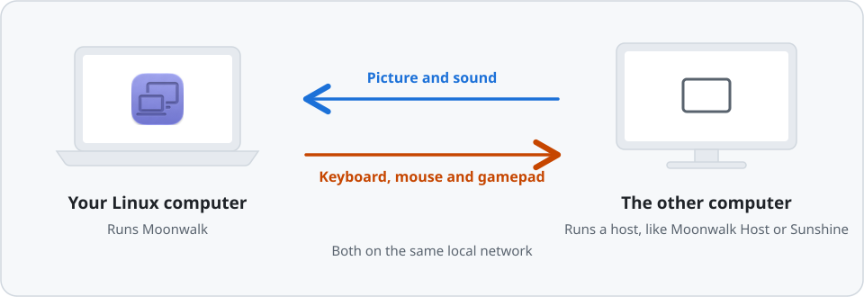

<p align="center">
  
</p>

<h1 align="center">Moonwalk</h1>

<p align="center">Remote desktop streaming for Linux, with a native interface for GNOME and KDE Plasma.</p>

<p align="center">
  <a href="docs/guides/getting-started.md">Get started</a> ·
  <a href="docs/compatibility.md">Compatibility</a> ·
  <a href="https://github.com/joaodriessen/moonwalk/releases">Releases</a> ·
  <a href="docs/guides/troubleshooting.md">Troubleshooting</a>
</p>

<p align="center">
  <picture>
    <source media="(prefers-color-scheme: dark)" srcset="docs/assets/hosts-dark.png">
    
  </picture>
</p>

Moonwalk shows you the screen of another computer in a window on your Linux desktop, plays its sound, and sends your keyboard, mouse and gamepad back to it.

You might use it to work on a Mac mini in another room from your laptop, or to play a game that runs on your desktop PC. The other computer does the work. Your Linux computer only has to show the picture.

> [!NOTE]
> Moonwalk is a **private alpha**. It's in daily use on one set of computers, and it hasn't yet been tried on many others. There is no public download yet. See [where things stand](#where-things-stand).

## How it works

<p align="center">
  <picture>
    <source media="(prefers-color-scheme: dark)" srcset="docs/assets/how-it-works-dark.svg">
    
  </picture>
</p>

Two programs work together. **Moonwalk** runs on the computer in front of you. A **host** runs on the computer you want to use. The first time they meet, you pair them with a four-digit PIN, so only the devices you approve can connect.

## What you need

- **The computer in front of you:** 64-bit Intel or AMD Linux, with [Flatpak](https://flatpak.org/setup/). Most computers can decode video on their graphics chip, which keeps the stream smooth.
- **The computer you want to use:** a Mac with [Moonwalk Host](https://github.com/joaodriessen/Skylight), or a Windows or Linux PC with [Sunshine](https://github.com/LizardByte/Sunshine), [Apollo](https://github.com/ClassicOldSong/Apollo) or [Vibepollo](https://github.com/Nonary/Vibepollo).
- **Between them:** the same local network. A cable gives the steadiest picture, but good Wi-Fi works too.

## Getting started

1. Download the `.flatpak` from [Releases](https://github.com/joaodriessen/moonwalk/releases) if a build has been posted. Otherwise, [build Moonwalk from source](docs/building.md). In the download folder, replace `Moonwalk-VERSION.flatpak` below with that exact filename (older builds start with `Starlight`):
   ```bash
   flatpak install --user ./Moonwalk-VERSION.flatpak
   flatpak run com.starlight.Starlight
   ```
2. Start the host on the other computer. It should appear in Moonwalk's list within a few seconds.
3. Select it and press **Pair**. Moonwalk shows a PIN. Enter that PIN on the host.
4. Press **Connect**.

The [getting started guide](docs/guides/getting-started.md) goes through this with pictures, including what to do if the host doesn't appear.

## GNOME and KDE Plasma

Moonwalk draws itself the way the desktop you're using expects. Both versions below have the same settings and abilities. It chooses by itself, so there's nothing to set up.

<table>
  <tr>
    <th width="50%">GNOME</th>
    <th width="50%">KDE Plasma</th>
  </tr>
  <tr>
    <td>
      <picture>
        <source media="(prefers-color-scheme: dark)" srcset="docs/assets/hosts-dark.png">
        
      </picture>
    </td>
    <td>
      <picture>
        <source media="(prefers-color-scheme: dark)" srcset="docs/assets/kde-dark.png">
        
      </picture>
    </td>
  </tr>
</table>

On Hyprland and other desktops it uses the GNOME-style layout, follows your light or dark preference, and lets your window manager decide the window's size.

<sub>Current GNOME and Plasma layouts, rendered with synthetic host data. The pictures illustrate the interface, not measured streaming performance. This page follows your GitHub light or dark theme.</sub>

## What you can do

Everything in the first group works with any compatible host. The second group depends on the host, because the host has to support it too.

**With any host**

- **Settings chosen for you.** Resolution and frame rate follow the screen you're using, and each host remembers its own settings.
- **Help when a connection fails.** Moonwalk tells you which step it reached and offers to retry, go back to the last settings that worked, or try safe ones.
- **Controls while you stream.** Mute, go fullscreen, take your mouse back or disconnect from a small bar at the top of the stream, and check the connection in the panel it opens.
- **Wake a sleeping computer.** Moonwalk can send a wake signal and connect when the computer responds. The computer and your network have to be set up to accept it.

**Depending on the host**

| | Moonwalk Host | Apollo and Vibepollo | Sunshine and others |
| --- | :---: | :---: | :---: |
| Copy and paste text automatically | ✓ | ✓ | Type it with a shortcut instead |
| Copy and paste images | ✓ | | |
| Send and receive files | ✓ | | |
| See the host's cursor shapes | ✓ | | |
| Choose the remote text size | ✓ | | |
| Lower quality automatically on a weak connection | ✓ | ✓ | |
| Change bitrate without reconnecting | ✓ | ✓ | |
| A separate virtual screen for your session | ✓ | ✓ | |

Bitrate control requires a compatible host version. Moonwalk Host can change its encoder target in place. On some Apollo-family encoders a bitrate change briefly interrupts video even without reconnecting; Automatic limits costly changes. Some features also need the host's own settings to allow them. [While you're streaming](docs/guides/while-streaming.md) explains each one.

See the [compatibility matrix](docs/compatibility.md) for tested scope and remaining limitations.

## Where things stand

Moonwalk has been used for real work on a small number of computers. Try it if you don't mind reporting problems. It's too early if you need it to be dependable.

- **Installing:** builds are shared with invited testers. There's no Flathub listing and no automatic updates. To update, install a newer file.
- **What it connects to:** Moonwalk opens a target named **Desktop** on the host, and doesn't have a game or app picker.
- **Where it works:** it's made for your local network. It isn't set up for streaming across the internet.
- **Graphics:** video decoding depends on your graphics hardware and drivers, and some combinations haven't been tried.
- **Languages:** English is complete. French, German and Dutch are partly translated and fall back to English.
- **Security:** neither Moonwalk nor the engine it's built on has had an independent audit, so only pair with hosts you trust. See [Security](SECURITY.md).

If something doesn't work, [troubleshooting](docs/guides/troubleshooting.md) covers the common problems, and [issues](https://github.com/joaodriessen/moonwalk/issues) are welcome.

## Guides

| Guide | What's in it |
| --- | --- |
| [Getting started](docs/guides/getting-started.md) | Install, pair and connect, step by step |
| [Settings](docs/guides/settings.md) | What each setting does, and when to change it |
| [While you're streaming](docs/guides/while-streaming.md) | Stream controls, shortcuts, clipboard and files |
| [Smoother streaming](docs/guides/performance.md) | What to try when the picture stutters |
| [Troubleshooting](docs/guides/troubleshooting.md) | Common problems and fixes |
| [Questions and answers](docs/guides/faq.md) | Short answers, including how it relates to Moonlight |
| [How it works](docs/guides/how-it-works.md) | A closer look, and what Moonwalk sends over your network |

## Working on Moonwalk

Bug reports, fixes and clear ideas are welcome. Start with [contributing](CONTRIBUTING.md), then see [building from source](docs/building.md), the [development workflow](docs/development.md) and the [architecture](docs/ARCHITECTURE.md).

## Credits and license

Moonwalk is a fork of [Moonlight Qt](https://github.com/moonlight-stream/moonlight-qt) and uses its streaming engine and [moonlight-common-c](https://github.com/moonlight-stream/moonlight-common-c). Without years of work by the Moonlight developers, it wouldn't exist. It also relies on Qt, FFmpeg, SDL and other open-source libraries listed in the build files. See [upstream provenance](docs/upstream.md) for the starting point of this source tree. Its interface icons come from [Lucide](https://lucide.dev), with ISC and Feather-derived MIT notices in [app/res/lucide/LICENSE](app/res/lucide/LICENSE).

Moonwalk is free software under the [GPL-3.0](LICENSE). The [notice inventory](docs/third-party-notices.md) lists the source notices installed with current Linux builds and the remaining distribution review.

Moonwalk was called Starlight until November 2026, and its Mac host was called Skylight. The app ID `com.starlight.Starlight`, and the `starlight` command keep the old name, so your settings and pairings carry over.
