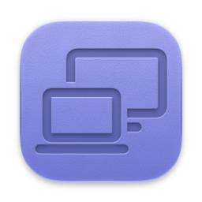

  

<h1 align="center">Moonwalk</h1>

  <a href="docs/guides/getting-started.md">Get started</a> ·
  <a href="docs/compatibility.md">Compatibility</a> ·
  <a href="docs/guides/troubleshooting.md">Troubleshooting</a>

Moonwalk streams another computer's desktop to Linux. Open a stream in a window
or fullscreen and use your keyboard, mouse, or gamepad as if you were sitting at
the other machine. It's built on Moonlight Qt, with an interface for GNOME and KDE
Plasma and stream settings you can save for each host.

> [!NOTE]
> Moonwalk is alpha software. If you have a tester build, follow the
> [install guide](docs/guides/getting-started.md). You can also
> [build from source](docs/building.md).

  <picture>
    <source media="(prefers-color-scheme: dark)" srcset="docs/assets/hosts-dark.png">
    
  </picture>

## What you need

- An **x86-64 Linux** computer for Moonwalk. Flatpak is the primary build.
- A **host** on the computer you want to use. [Sunshine](https://github.com/LizardByte/Sunshine)
  runs on Windows and Linux. [Apollo](https://github.com/ClassicOldSong/Apollo)
  and [Vibepollo](https://github.com/Nonary/Vibepollo) are Windows options.
  [Moonwalk Host](https://github.com/joaodriessen/moonwalk-host) is the companion
  app for Apple Silicon Macs running macOS 14 or later.
- A **local network** both machines can reach. Use a network and hosts you trust.

Start the host and make sure it has a **Desktop** entry. Select the host in
Moonwalk, click **Pair**, and enter the PIN on the other computer. Then click
**Connect**. The
[setup guide](docs/guides/getting-started.md) walks through discovery, pairing,
and adding a host by address.

## What Moonwalk does

- **Starts with your display.** Automatic uses your screen's resolution and
  refresh rate as targets, then accounts for what the host and your decoder can
  handle. Each host keeps its own Manual settings.
- **Keeps a working stream connected.** Moonwalk can adjust bitrate in place on
  hosts that support it. It saves picture changes for the next connection, or
  you can choose **Apply Now** to reconnect yourself.
- **Puts stream controls within reach.** Use the handle at the top of the picture
  to mute, release input, change the view, or disconnect. Disconnect returns
  you to the host list while Moonwalk asks the host to end the Desktop session.
- **Uses the features the host offers.** Depending on host version and
  permissions, that can include clipboard sync, a virtual display, and live
  bitrate changes. Moonwalk Host also supports image clipboard and file transfer.

The [compatibility guide](docs/compatibility.md) has the tested setups and feature
limits. The standard connection uses PIN pairing and the host's existing
**Desktop** entry. Open games from the remote desktop.

## GNOME and KDE Plasma

Moonwalk picks a layout based on your desktop. On Hyprland and other desktops,
it uses the GNOME-style layout and lets the compositor manage the window.

  <picture>
    <source media="(prefers-color-scheme: dark)" srcset="docs/assets/kde-dark.png">
    
  </picture>

The GNOME and Plasma screenshots use example hosts.

## Help and development

- [Settings](docs/guides/settings.md) · [Stream controls and shortcuts](docs/guides/while-streaming.md) · [Performance](docs/guides/performance.md)
- [Troubleshooting](docs/guides/troubleshooting.md) · [Questions and answers](docs/guides/faq.md) · [Report an issue](https://github.com/joaodriessen/moonwalk/issues/new/choose)
- [Build from source](docs/building.md) · [Contributing](CONTRIBUTING.md) · [Changelog](CHANGELOG.md) · [Security](SECURITY.md)

## Credits and license

Moonwalk is a fork of [Moonlight Qt](https://github.com/moonlight-stream/moonlight-qt)
and uses its [moonlight-common-c](https://github.com/moonlight-stream/moonlight-common-c)
streaming library. The interface uses icons from [Lucide](https://lucide.dev).
See [upstream provenance](docs/upstream.md) and the
[third-party notices](docs/third-party-notices.md). Moonwalk is licensed under
the [GPL-3.0](LICENSE).

Earlier builds were called Starlight. The Flatpak ID
`com.starlight.Starlight` and the `starlight` command still use that name.
