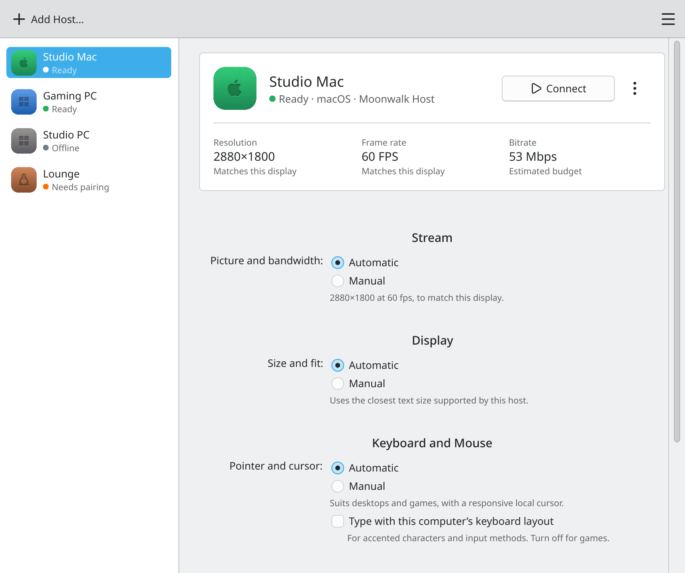

  

<h1 align="center">Moonwalk</h1>

  <a href="docs/guides/getting-started.md">Get started</a> ·
  <a href="docs/compatibility.md">Compatibility</a> ·
  <a href="docs/guides/troubleshooting.md">Troubleshooting</a>

Moonwalk lets you use another computer from your Linux desktop. It shows the
remote picture and plays its sound, and sends your keyboard, mouse, and gamepad
input back. It uses the Moonlight Qt engine, with GNOME and KDE Plasma layouts and
settings you can save separately for each host.

> [!NOTE]
> Moonwalk is alpha software. If you have a tester build, follow the
> [install guide](docs/guides/getting-started.md). You can also
> [build from source](docs/building.md).

  <picture>
    <source media="(prefers-color-scheme: dark)" srcset="docs/assets/hosts-dark.png">
    
  </picture>

## What you need

- An **x86-64 Linux** computer for Moonwalk. Flatpak is the primary build.
- A **host app** on the computer you want to use. [Sunshine](https://github.com/LizardByte/Sunshine)
  runs on Windows and Linux. [Apollo](https://github.com/ClassicOldSong/Apollo)
  and [Vibepollo](https://github.com/Nonary/Vibepollo) are Windows options.
  [Moonwalk Host](https://github.com/joaodriessen/moonwalk-host) is an option for
  Apple Silicon Macs running macOS 14 or later.
- A **local network** both machines can reach. Use a network and hosts you trust.

Start the host app and make sure its app list includes **Desktop**. Select the
host in Moonwalk and click **Pair**. Enter the PIN Moonwalk shows in the host
app's pairing screen, then click **Connect** in Moonwalk. If the host doesn't
appear, the [setup guide](docs/guides/getting-started.md) shows how to add it by
address.

## What happens when you connect

- **Automatic** starts with your screen's resolution and refresh rate, then
  accounts for what the host and decoder can handle.
- On hosts with live bitrate control, Moonwalk can adjust bitrate during the
  stream. It saves resolution changes for next time. Use **Apply Now** if you
  want to reconnect with a change right away.
- Click the handle at the top of the picture to mute sound, release input, fit
  the picture, or disconnect. **Disconnect** takes you straight back to the host
  list while Moonwalk asks the host to end the Desktop session.
- Clipboard sync, virtual displays, and live bitrate changes depend on the host
  and what it permits your device to do. Moonwalk Host also offers image
  clipboard and file transfer.

You can open games from the remote desktop. The [compatibility guide](docs/compatibility.md)
shows the setups we've tried and which features each host offers.

## GNOME and KDE Plasma

Moonwalk picks a layout based on your desktop. On Hyprland and other desktops
it uses the generic layout, with window placement handled by your compositor.

  <picture>
    <source media="(prefers-color-scheme: dark)" srcset="docs/assets/kde-dark.png">
    
  </picture>

The GNOME and Plasma screenshots use example hosts.

## Help and development

- [Settings](docs/guides/settings.md) · [Stream controls and shortcuts](docs/guides/while-streaming.md) · [Performance](docs/guides/performance.md)
- [Troubleshooting](docs/guides/troubleshooting.md) · [Questions and answers](docs/guides/faq.md) · [Report an issue](https://github.com/joaodriessen/moonwalk/issues/new/choose)
- [Build from source](docs/building.md) · [Contributing](CONTRIBUTING.md) · [Changelog](CHANGELOG.md) · [Security](SECURITY.md)

## Credits and license

Moonwalk is a fork of [Moonlight Qt](https://github.com/moonlight-stream/moonlight-qt)
and uses its [moonlight-common-c](https://github.com/moonlight-stream/moonlight-common-c)
streaming library. The interface uses icons from [Lucide](https://lucide.dev).
See [upstream provenance](docs/upstream.md) and the
[third-party notices](docs/third-party-notices.md). Moonwalk is licensed under
the [GPL-3.0](LICENSE).

Earlier builds were called Starlight. The Flatpak ID
`com.starlight.Starlight` and the `starlight` command still use that name.
