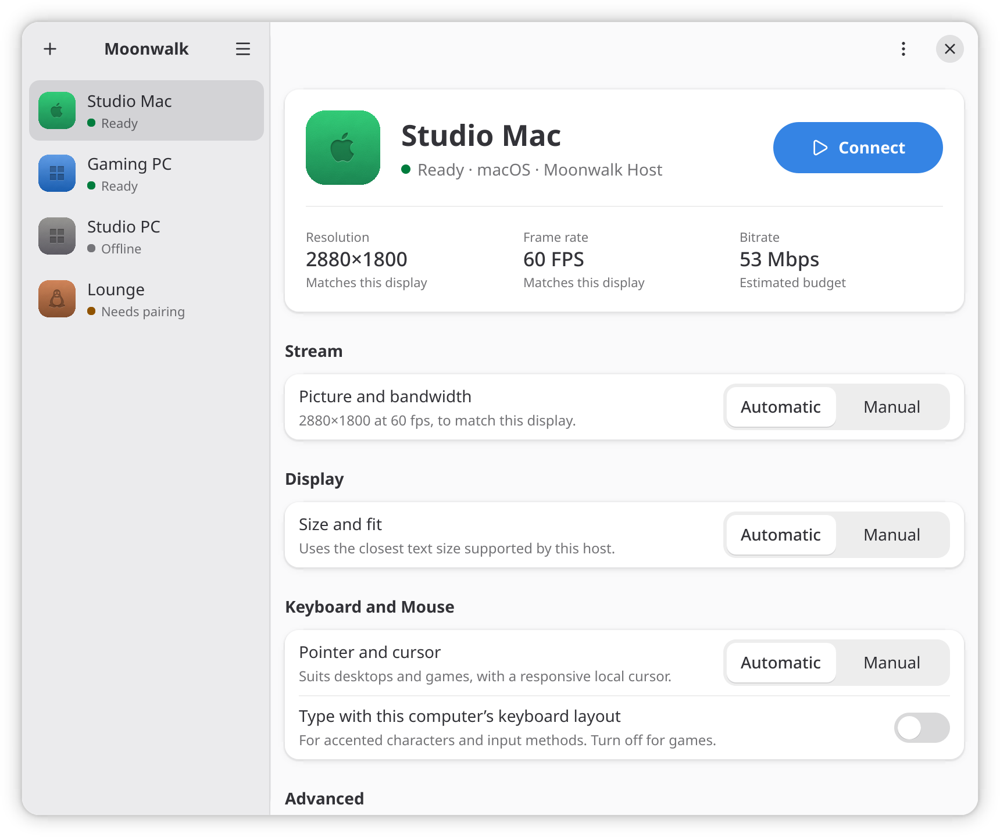

# Moonwalk

**Open your Mac desktop from Linux.**

Open Finder, use a Mac-only app, or bring a file back to Linux without
walking over to the Mac. **Moonwalk** runs on Linux.
**[Moonwalk Host](https://github.com/joaodriessen/moonwalk-host)** runs on the
Mac. Once you've paired them, pick the Mac and click **Connect**.

[Set up the two apps](#connect-to-your-mac) ·
[Use the host you already have](#already-using-sunshine)

<picture>
  <source media="(prefers-color-scheme: dark)" srcset="docs/assets/hosts-dark.png">
  
</picture>

Moonwalk on GNOME with an example Mac selected. The numbers show the request for the next stream.

## Connect to your Mac

1. **On the Mac**, install [Moonwalk Host](https://github.com/joaodriessen/moonwalk-host/blob/main/docs/INSTALL.md).
   It needs Apple Silicon, macOS 14 or later, and permission to capture the
   screen and send input. Leave the Mac awake and logged in.
2. **On Linux**, install Moonwalk from a tester Flatpak on an x86-64 computer.
   Both machines should be on the same local network. Select the Mac and click
   **Pair**. [Install Moonwalk](docs/guides/getting-started.md#install-moonwalk)
3. **Back on the Mac**, open **Pair New Device…** from the Moonwalk Host menu
   bar icon. Select the pending device and enter the PIN shown on Linux. Then
   click **Connect** in Moonwalk.

Both apps are in alpha. Tester builds are distributed privately. You can
also [build Moonwalk from source](docs/building.md). If the Mac doesn't appear,
copy its local address from **Moonwalk Host → Settings… → Network** and paste
it into **Add Host…** on Linux.

## A desktop that fits the computer you're using

A Mac mini can stay tucked away without a monitor. Moonwalk asks for your
Linux screen's size and refresh rate, and Moonwalk Host can create a display
for the stream. On supported modes, the two can also agree on a text size
so your Mac apps stay readable.

Copy a screenshot to Linux, send a file back, or use the Mac's sound. The
small handle at the top of the picture opens the controls. **Disconnect**
takes you straight back to your Linux host list while Moonwalk asks the
Mac to end the stream. You stay logged in on the Mac.
[Stream controls and shortcuts](docs/guides/while-streaming.md)

Moonwalk tries to keep the picture steady when the link gets busy. With
live bitrate support it can lower bitrate and raise it again without leaving
the stream. A different resolution can wait until the next time you connect.
[How Automatic works](docs/guides/performance.md#what-automatic-changes)

## Already using Sunshine?

Keep your host app. Moonwalk opens the **Desktop** entry on compatible hosts,
including [Sunshine](https://github.com/LizardByte/Sunshine) on Linux and Windows
and [Apollo](https://github.com/ClassicOldSong/Apollo) or
[Vibepollo](https://github.com/Nonary/Vibepollo) on Windows. You can open games
from the remote desktop and play with a supported gamepad. Clipboard, virtual
displays, and live bitrate depend on your host and its permissions.
[Features by host](docs/compatibility.md#features-by-host)

Moonwalk has GNOME and KDE Plasma layouts. For other desktops, including
Hyprland, it uses a generic layout and follows the compositor's window
placement. Stream and input settings are saved per host.

[Setup and troubleshooting](docs/guides/README.md) ·
[Compatibility](docs/compatibility.md) · [Security](SECURITY.md) ·
[Contribute](CONTRIBUTING.md) · [Changelog](CHANGELOG.md)

Moonwalk is built on [Moonlight Qt](https://github.com/moonlight-stream/moonlight-qt)
and uses [Lucide](https://lucide.dev) icons. Its license is [GPL-3.0](LICENSE).
[Upstream history](docs/upstream.md) · [Third-party notices](docs/third-party-notices.md)
