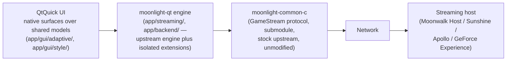

# Architecture

This is the onboarding-level map of how Moonwalk is put together. It links to the deeper design
docs rather than duplicating them — read those for the full reasoning and evidence trail.

## Upstream engine and Moonwalk extensions

Moonwalk is a sovereign fork of [moonlight-qt](https://github.com/moonlight-stream/moonlight-qt).
The governing rule, in full in
[`docs/design/2026-07-13-phase1.md`](design/2026-07-13-phase1.md):

- **Upstream engine.** `app/streaming/` and `app/backend/` stay close to Moonlight Qt, with small isolated fixes and Moonwalk extensions for clipboard, cursor shapes, local media keys, host lifetime and cancellation.
  Changes there are small, commit-isolated, and upstream-shaped, tracked via the live `upstream`
  git remote plus cherry-picks — not a one-time copy.
- **The UI is the fork.** `app/gui/` is a from-scratch Qt Quick interface with a native
  surface per desktop. The sidebar lists hosts only; every host owns one page with its next
  action and then Quality, Display, input and audio settings. Application preferences are
  separate; host preferences stay on the host page.
- **No invented settings.** Every control binds to a `StreamingPreferences` property that already
  exists in the upstream engine (or was promoted from an env-gate to a real preference during the
  wrapper era). No UI element implies a capability the engine doesn't have.

Decode pipeline: FFmpeg (bundled, patched for the Moonlight ecosystem) with NVIDIA NVDEC and
VAAPI/VDPAU/Vulkan hardware acceleration, including a bundled legacy `i965` driver for
pre-Broadwell Intel iGPUs. See [Flatpak packaging](#flatpak-packaging) below for exactly how
that's wired up, and the
[troubleshooting guide](guides/troubleshooting.md#is-hardware-video-decoding-working)
for checks when playback stutters.

## Native routes and ownership

`main.qml` owns navigation and window effects. `HostPageRoute` and `SettingsPageRoute` select the surface: GNOME and every desktop without its own adapter use `adaptive/gnome/` (GNOME adds client-side window chrome; elsewhere the compositor owns the frame), Plasma uses `adaptive/plasma/`, and `STARLIGHT_ADAPTIVE_SHELL=0` keeps the legacy `PcView`/`SettingsView`. The Plasma pages need Kirigami, so they load by URL and the Plasma adapter only activates when `PlasmaStyleProbe` can import it.

Shared `HostPageContext` and `SettingsPageContext` own workflow and preferences. Surfaces reach them only through their facades. `app/streaming/clipboardsync.*`, `cursorsync.*` and local input handling are maintained Moonwalk extensions, not pristine upstream directories. Keep engine fixes narrow and exercise their actual C++ seams in addition to QML facades.

## One declaration, native surfaces

`adaptive/settings/` is what keeps the desktops equal:

- `HostPresentation.qml` states a host's status, its next action and every per-host setting as `SettingRow` objects grouped by `SettingGroup`.
- `AppSettingsModel.qml` does the same for application preferences.
- `HostDialogState.qml` holds what each host dialog says and what its responses do.

To add a setting, add one row: `GnomeSettingsList` paints it as a boxed row and `PlasmaSettingsForm` as a `Kirigami.FormLayout` row, and `tst_nativeparity` fails if either surface lacks a declared control. A host limitation stays visible with `sensitive: false` and its reason in the subtitle. A `choice` row shows a few options at once: an AdwToggleGroup on GNOME, radio buttons on Plasma.

`HostAvatar` gives each host its coloured tile on both desktops, and `HostPresentation` says what the next connection will be (`streamFacts`) and what a host's state means, so each page only arranges them.

## Controls follow the desktop

`app/gui/style/StarlightAdwaita/` is a real Qt Quick Controls style built from the `adaptive/gnome/` controls, selected in `main.cpp` for everything outside Plasma, command-line launches included; ordinary Plasma launches select `org.kde.desktop`. `SessionControls`, `SessionStatusView`, `FileTransferPane` and the message dialogs use plain Controls, so each desktop's style paints them. Material remains only behind the `STARLIGHT_ADAPTIVE_SHELL=0` legacy opt-out.

`adaptive/gnome/GnomeTokens.qml` holds libadwaita's values and follows `AppearanceProvider`, which reads the Settings portal for colour scheme, accent, contrast, reduced motion, fonts and button layout on GNOME and generic desktops.

Use `tests/preview/preview.py` to render any scene on any surface with test doubles and private state.

The older `app/gui/starlight/` `SL*` primitives and `Theme.qml` remain for the legacy shell.

## Settings ownership: Moonwalk (client) ↔ Moonwalk Host (host)

Full contract, request/clamp table, and the owner's rulings live in
[`docs/design/settings-ownership.md`](design/settings-ownership.md). The short version: a client
setting and a host setting answer different questions — the client expresses a user's preference
for this session, the host expresses a machine capability and an operator policy. Neither side can
own a shared value alone, so genuine overlaps (bitrate, codec, resolution/fps, cursor) are
request/clamp pairs, not duplicated controls.

## Per-host settings

Every paired host gets its own resolution/fps/bitrate/codec profile instead of one profile shared
globally. The full design — data model, migration path, and exact code citations against the
upstream `StreamingPreferences` singleton — lives in
[`docs/design/2026-07-14-per-host-settings.md`](design/2026-07-14-per-host-settings.md).

## Flatpak packaging

`flatpak/com.starlight.Starlight.yaml` is the primary distribution mechanism (AppImage was
dropped). It builds, in order: `nv-codec-headers` (enables FFmpeg's NVDEC at build time),
`libplacebo`, `libdecor`, SDL3/SDL2-compat/SDL2_ttf, `dav1d`, a patched **FFmpeg** fork with NVDEC
plus VAAPI/VDPAU/Vulkan hardware-accelerated decoders, **libdrm** (built locally because the SDK's
stock copy ships only core headers, not `libdrm_intel`), **intel-vaapi-driver** (the legacy `i965`
driver, targeted specifically at pre-Broadwell Intel iGPUs where the modern `iHD` driver doesn't
apply), **QAdwaitaDecorations** (a native GNOME titlebar with a real drop shadow — Qt's own
in-tree Wayland decoration plugin dropped shadow painting), a gamescope WSI Vulkan layer, the
Moonwalk app itself (built last, with AOT-compiled QML via `qtquickcompiler`), and finally
`libva-utils` for the `vainfo` diagnostic command documented in the
[troubleshooting guide](guides/troubleshooting.md).

Notable runtime environment choices baked into the manifest, each with its own inline comment
explaining the "why":

- `LIBVA_DRIVER_NAME` is deliberately left **unset** (not set-empty) so libva auto-detects per GPU
  — on Haswell-class hardware it tries `iHD`, that fails, and it falls back to the bundled `i965`.
- `QML_DISABLE_DISK_CACHE=1` closes a residual interpreted-fallback path around a measured bug
  where Flatpak's reproducible-build timestamp normalization defeated Qt's QML disk-cache
  invalidation after an update.

## Inherited scaffolding this fork does not build or maintain

Moonwalk releases target Linux. The repository retains the upstream build
scaffolding for Windows, macOS and Steam Link so maintainers can compare changes
with Moonlight Qt. These platforms are outside Moonwalk’s release scope.
The public development history starts with a reviewed Moonwalk source snapshot.
See [upstream provenance](upstream.md) for the comparison base and update process.

## See also

- [`docs/design/2026-07-13-phase1.md`](design/2026-07-13-phase1.md) — fork doctrine in full
- [`docs/design/2026-07-14-per-host-settings.md`](design/2026-07-14-per-host-settings.md) —
  per-host settings architecture
- [`docs/design/settings-ownership.md`](design/settings-ownership.md) — Moonwalk ↔ Moonwalk Host
  settings-ownership contract
- [`CONTRIBUTING.md`](../CONTRIBUTING.md) — what this doctrine means in practice for a
  contribution
