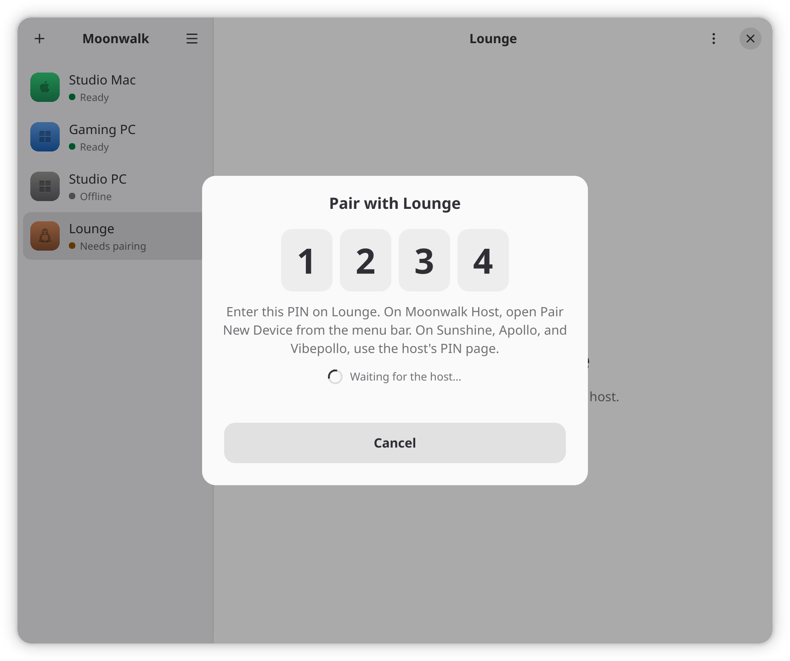

# Getting started

## Set up a host

Install and start host software on the computer you want to control. Use
[Sunshine](https://github.com/LizardByte/Sunshine) on Windows or Linux, or
[Apollo](https://github.com/ClassicOldSong/Apollo) or
[Vibepollo](https://github.com/Nonary/Vibepollo) on Windows. If you're testing the
Mac companion, see [Moonwalk Host](https://github.com/joaodriessen/Skylight).
You'll need access to that separate private alpha.

In the host's application list, look for **Desktop**. Moonwalk uses this entry
to open the remote desktop. Moonwalk Host includes it. On hosts that manage an
application list, add **Desktop** with no launch command if it's missing.

## Install Moonwalk

Use the Flatpak bundle supplied for testing, or [build from source](../building.md).
If you don't have Flatpak yet, follow [the setup instructions](https://flatpak.org/setup/)
for your distribution.

Run these commands from the directory containing your bundle. Substitute its
filename for `Moonwalk-VERSION.flatpak`. Some tester builds start with
`Starlight`.

```sh
flatpak install --user ./Moonwalk-VERSION.flatpak
flatpak run com.starlight.Starlight
```

If Flatpak can't find the KDE 6.10 runtime, make sure Flathub is configured
and install it with `flatpak install --user flathub org.kde.Platform//6.10`.
You can also open **Moonwalk** from your app launcher after installation.

## Find the host

With both computers on the same local network, open Moonwalk. Hosts it
discovers appear in the sidebar.

<p align="center">
  <picture>
    <source media="(prefers-color-scheme: dark)" srcset="../assets/first-launch-dark.png">
    
  </picture>
</p>

If the host doesn't appear, use **Add Host…** and enter the other computer's
address. See [finding your host](troubleshooting.md#i-cant-find-my-host) for
where to look up the address.

## Pair and connect

1. Select the host and press **Pair**. Moonwalk shows a four-digit PIN.
2. Enter the PIN in the host's pairing screen. In Sunshine, open **PIN** in
   the host web interface, usually at `https://localhost:47990` on the host.
   Apollo and Vibepollo have a similar pairing page. On Moonwalk Host, use
   **Pair New Device…** in the Mac menu bar and select the pending device.
   Any login the host's web interface requires happens there.
3. When the host accepts the PIN, press **Connect** in Moonwalk.

<p align="center">
  <picture>
    <source media="(prefers-color-scheme: dark)" srcset="../assets/pin-dark.png">
    
  </picture>
</p>

**Resume Desktop** means the host still has a Desktop target running.
**Switch to Desktop** means another application is running. Read the
confirmation before ending or taking over an existing session.

The host page shows the resolution, frame rate, and bitrate Moonwalk plans
to request. Start with **Automatic**. The host and decoder can limit what the
stream actually delivers.

## During the stream

Press **Ctrl+Alt+Shift+Z** to release your keyboard and mouse. Click the
picture to control the host again. Press **Ctrl+Alt+Shift+Q** to disconnect,
or open the controls at the top of the picture and choose **Disconnect**.

Moonwalk returns to the host list while it asks the host to end the Desktop
stream. Your remote desktop applications stay open. See
[stream controls and shortcuts](while-streaming.md) for details.

## Update or remove Moonwalk

Close Moonwalk before installing a newer bundle with the same command.
Settings and pairings use the same Flatpak app ID. Builds are distributed
manually during the private alpha.

To remove the user installation, run:

```sh
flatpak uninstall --user com.starlight.Starlight
```

Add `--delete-data` only if you also want to remove Moonwalk's settings,
hosts, and pairings.

[Settings](settings.md) · [Troubleshooting](troubleshooting.md) · [All guides](README.md)
