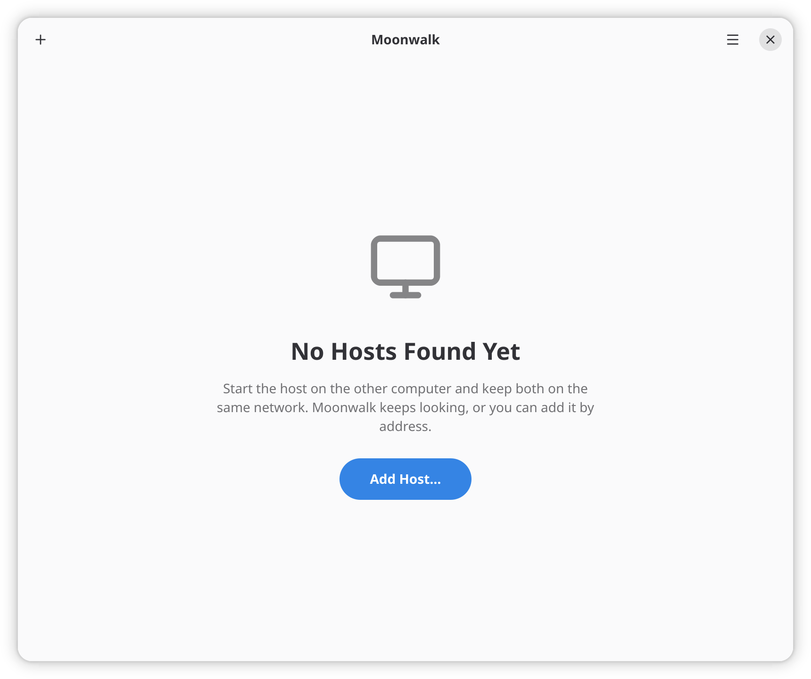
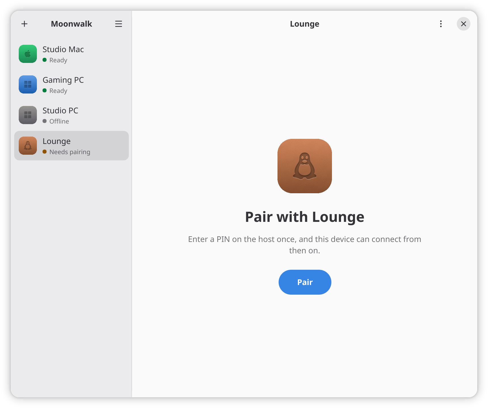

# Getting started

You'll install Moonwalk, introduce it to the other computer once, and connect. Once the other computer is ready, this takes a few minutes.

## Before you start

The other computer needs to be running a **host**, which is the program that shares its screen. Install it first, following the host's own instructions:

- **On a Mac,** use [Moonwalk Host](https://github.com/joaodriessen/Skylight).
- **On a Windows or Linux PC,** use [Sunshine](https://github.com/LizardByte/Sunshine), [Apollo](https://github.com/ClassicOldSong/Apollo) or Vibepollo.

Moonwalk opens an application called **Desktop** on the host, which shows the whole screen. Moonwalk Host has one already. On other hosts, check the list of applications in the host's settings. If there's no `Desktop`, add an application with that name and leave its command empty.

## 1. Install Moonwalk

Download the `.flatpak` file from [Releases](https://github.com/joaodriessen/moonwalk/releases). Builds are currently shared with invited testers, so you'll need access to this repository.

Then open a terminal in your Downloads folder. Replace `Moonwalk-VERSION.flatpak` with the **exact filename you downloaded**, including its version and revision. Older releases have names starting with `Starlight`; use their actual name. Avoid a wildcard when several builds are in the same folder:

```bash
cd ~/Downloads
flatpak install --user ./Moonwalk-VERSION.flatpak
flatpak run com.starlight.Starlight
```

Flatpak may offer to download the KDE 6.10 runtime, which Moonwalk runs on. Say yes. If it can't find the runtime, run `flatpak install flathub org.kde.Platform//6.10` first. After installing, Moonwalk also appears in your desktop's app launcher.

If you don't have Flatpak yet, [Flatpak's setup page](https://flatpak.org/setup/) has instructions for each Linux distribution.

To update, finish streaming and close Moonwalk, then install the newer bundle in the same way. Settings and pairings stay under the same app ID. There is no automatic updater yet. A newer source checkout does not mean a newer downloadable build; check the release notes and **About Moonwalk**.

See [compatibility](../compatibility.md) before choosing a host or assuming an optional feature is available.

## 2. Find the other computer

Make sure the host is running on the other computer and that both computers are on the same network. Moonwalk looks for hosts by itself, and any it finds appear in the list.

<p align="center">
  <picture>
    <source media="(prefers-color-scheme: dark)" srcset="../assets/first-launch-dark.png">
    
  </picture>
</p>

**If nothing appears** after a little while, press **Add Host…** and type the other computer's address, shown in its network settings. [Finding that address](troubleshooting.md#i-cant-find-my-host) is covered in troubleshooting.

## 3. Pair them

You only do this once for each host. It proves that you control both computers.

Select the host and press **Pair**.

<p align="center">
  <picture>
    <source media="(prefers-color-scheme: dark)" srcset="../assets/pair-dark.png">
    
  </picture>
</p>

Moonwalk then shows a four-digit PIN and waits.

<p align="center">
  <picture>
    <source media="(prefers-color-scheme: dark)" srcset="../assets/pin-dark.png">
    
  </picture>
</p>

Enter that PIN **on the other computer**:

- **Moonwalk Host:** click the Moonwalk Host icon in the Mac's menu bar, choose **Pair New Device…**, select your computer, type the PIN and press **Pair Device**.
- **Sunshine and Apollo:** on that computer, open the host's web page. For Sunshine, that's `https://localhost:47990`, which is also available from its tray icon. Go to **PIN**, type the PIN and submit it. Your browser may warn about the page's certificate, and you may need to create a login the first time.

Moonwalk notices when you've finished and closes the dialog.

## 4. Connect

Press **Connect**. Moonwalk shows you what it's doing, and then the other computer's screen appears.

If you've connected before, the button may say **Resume Desktop**, when a previous target is still resumable on the host. **Switch to Desktop** means another app is running on the host, and Moonwalk asks before quitting it.

<p align="center">
  <picture>
    <source media="(prefers-color-scheme: dark)" srcset="../assets/hosts-dark.png">
    
  </picture>
</p>

The card shows what you're about to get. Moonwalk normally matches your screen's resolution and refresh rate, so you shouldn't need to change anything first.

## 5. Take your keyboard and mouse back

While you're streaming, your keyboard and mouse belong to the other computer. To get them back, press **Ctrl+Alt+Shift+Z**. Click the stream to return.

To finish, press **Ctrl+Alt+Shift+Q**, or click **Controls** or the thin grip at the top of the stream and choose **Disconnect**. Whatever was running on the other computer keeps running.

[While you're streaming](while-streaming.md) covers everything else.

## Other things worth knowing

### Each host has its own settings

Resolution, frame rate, picture and input settings belong to each host, so each computer can be set up to suit it. Moonwalk reselects the last host you used. Pressing Enter in the list connects to it, or pairs or wakes it if that's what it needs.

### Coming from Moonlight

Moonwalk never changes your Moonlight setup, and the two apps keep separate settings. The Flatpak can't read Moonlight's settings, so you'll pair each host again. A build you compile yourself copies them the first time it opens, and leaves Moonlight's files alone.

### Updating

Download the newer `.flatpak` and install it the same way. Your hosts and settings stay. Moonwalk doesn't check for updates by itself.

### Removing Moonwalk

```bash
flatpak uninstall com.starlight.Starlight
```

To remove your hosts, pairings and settings as well, add `--delete-data`.

---

Next: [Settings](settings.md) · [While you're streaming](while-streaming.md) · [All guides](README.md)
