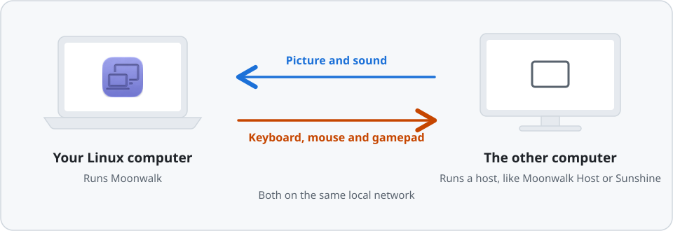

# How Moonwalk works

This is the longer explanation, for the curious. You don't need it to use Moonwalk.

  <picture>
    <source media="(prefers-color-scheme: dark)" srcset="../assets/how-it-works-dark.svg">
    
  </picture>

## What happens when you connect

1. **Capture.** The host records the other computer's screen and sound.
2. **Compress.** It turns the screen into compressed video using that computer's graphics hardware.
3. **Send.** The video and sound travel across your network.
4. **Decode.** Moonwalk decompresses the video, using your graphics hardware if it can.
5. **Show.** The picture appears in a window or fullscreen.
6. **Respond.** Your keyboard, mouse and gamepad go back the other way, and the cycle continues many times a second.

## Words you'll see

| Word | What it means |
| --- | --- |
| **Host** | The computer you're connecting to, or the program on it that shares the screen. |
| **Client** | The computer in front of you. Moonwalk is a client. |
| **Pairing** | Introducing a client to a host with a PIN, once, so they trust each other afterward. |
| **Bitrate** | How much data the stream uses each second. Higher looks sharper but asks more of your network. Measured in Mbps. |
| **Codec** | The format used to compress the video, such as H.264, HEVC or AV1. |
| **Decoder** | The part of your computer that decompresses the video. A hardware decoder is usually much more efficient than your processor. |
| **Virtual display** | A pretend screen that a host creates, sized for your session, so your stream doesn't have to use a physical screen. |
| **Moonlight-compatible** | Host software that speaks the protocol Moonlight uses. Sunshine, Apollo, Vibepollo and Moonwalk Host all do. |

## What the Flatpak includes

Flatpak packages Moonwalk with the libraries it needs, including video decoding libraries and drivers for some older graphics hardware. Your graphics hardware and drivers still decide what works.

The Flatpak has access to your network, display, sound and all devices, including gamepads. It can also read your system's installed files (not your home folder), adjust screen brightness and keep the screen awake.

## Moonwalk and Moonwalk Host

Moonwalk works with any Moonlight-compatible host. With [Moonwalk Host](https://github.com/joaodriessen/Skylight), the two apps can also share the Mac's cursor shapes, images on the clipboard and files, and agree on a desktop size that suits your screen. Those extras rely on both apps, so other hosts don't offer them. Apollo-compatible hosts have their own extras, which Moonwalk detects by asking the host what it supports.

## What Moonwalk sends over your network

Besides finding, pairing with and streaming from your hosts, Moonwalk can:

- download gamepad mappings and a host compatibility list from `moonlight-stream.org`
- ask `stun.moonlight-stream.org` for your public internet address when a host is added
- contact `qt.conntest.moonlight-stream.org` to work out why a connection failed

These are downloads and network tests, and nothing about you or your usage is uploaded. **Detect blocked connections automatically** in Preferences controls the test used when you add a host by hand. Some tests run after a failed stream regardless, so it isn't a complete offline switch.

## Going deeper

The [architecture document](../ARCHITECTURE.md) explains how the code is organized.

---

[All guides](README.md)
