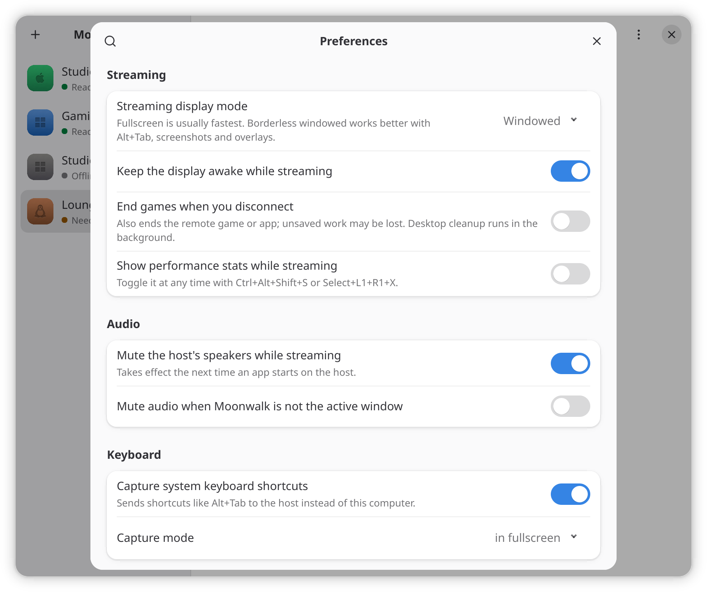

# Settings

Open a host's page to change that computer's stream, display, and input
settings. For settings that apply to every host, open **Preferences**
(**Configure Moonwalk…** on Plasma) or press **Ctrl+,**. Press **Ctrl+F** to
search Preferences.

Each host starts in **Automatic**. Switch a group to **Manual** to see its
controls. Moonwalk remembers those choices when you switch back to Automatic.

## Stream

Under **Picture and bandwidth**, Automatic starts with your display's size and
refresh rate, then accounts for host and decoder limits. The host card shows
what Moonwalk plans to request. Open Stream Controls to see how the stream is
actually running.

| Manual setting | What it changes |
| --- | --- |
| **Resolution** | Choose a fixed size, or match the local display on the next connection. |
| **Frame rate** | Choose a fixed rate, or match the screen's refresh rate. When Moonwalk can't read it, it uses 60 FPS. |
| **Video codec** | Choose Automatic, H.264, HEVC (H.265), or AV1. Both the host and the decoder must support the codec. |
| **Limit bandwidth** | Enables a manual video bitrate target. |
| **Bandwidth limit** | The chosen target in Mbps. The total network traffic also includes audio and protocol overhead. |

See [Streaming performance](performance.md) for what **Automatic**,
**Recommended**, and **Limited** mean on the host card.

## Display

**Size and fit** covers two screens. **View scale** changes how the picture
fits your window. **Host display** and **Remote text size** ask the host to
change the remote desktop where it supports those options.

| Manual setting | What it changes |
| --- | --- |
| **Remote text size** | On Moonwalk Host, scale the Mac desktop UI to **Small (1×)** or **Large (2×)**, or let Moonwalk choose. Large needs an even picture width and height. It takes effect when you connect. Windows text scaling is set on the host. |
| **View scale** | **Fit in Window** shows the full picture. **Actual Size** draws one remote pixel per local pixel. |
| **Host display** | Choose **Automatic**, **Use host setting**, **Dedicated virtual display**, or **Physical display** where supported. The host may deny a request or apply its own policy. Moonwalk reports when a requested virtual display cannot be prepared. |

[Which desktop you get](../compatibility.md#which-desktop-you-get) explains
how a host's display policy and retained sessions affect the result.

## Keyboard and Mouse

**Pointer and cursor** defaults to Automatic pointer movement with a local
cursor. In Manual, you can choose how movement is sent to the host:

- **Automatic** uses absolute positioning on desktops and relative movement
  for games.
- **Desktop** sends the cursor position on the picture.
- **Game** sends the distance and direction the mouse moved. Use it for games
  where the mouse turns a camera.

**Local cursor** draws the pointer on your computer so it can move without
waiting for video from the host. Moonwalk Host can coordinate its own cursor
with yours. If you see two pointers on another host, **Ctrl+Alt+Shift+N** asks
a supporting host to toggle its cursor.

**Type with this computer's keyboard layout** sends typed text, including
accents and input method text. Shortcuts still use keys. Turn it off if a
game needs the physical keys for movement or other controls.

## Advanced

- **Saved Settings** keeps named configurations for the selected host.
- **Re-evaluate This Host** clears learned performance limits and leaves
  pairing, Manual choices, presets, and last-working settings available.
- **Restore Last Working Settings** restores the settings from the last
  healthy stream.

Use **Host Details** in the host's menu to see its addresses or choose a
specific address. Keep the address on **Automatic** unless Moonwalk picks
the wrong route.

## Preferences

  <picture>
    <source media="(prefers-color-scheme: dark)" srcset="../assets/preferences-dark.png">
    
  </picture>

| Preference | When to use it |
| --- | --- |
| **Streaming display mode** | Choose how a stream opens. Borderless windowed mode makes switching between apps easier. |
| **End games when you disconnect** | Ask the host to quit a streamed game or app when you disconnect. This can lose unsaved work. Desktop session cleanup runs separately. |
| **Mute the host's speakers while streaming** | Keep audio from playing on both machines. Applies the next time a host app starts. |
| **Capture system keyboard shortcuts** | Send shortcuts such as Alt+Tab to the host when capture is active. |
| **Find hosts on the local network automatically** | Turn off discovery if you prefer to add hosts by address. |
| **Language** | Change the interface language. Untranslated labels appear in English. |

[Stream controls](while-streaming.md) · [All guides](README.md)
