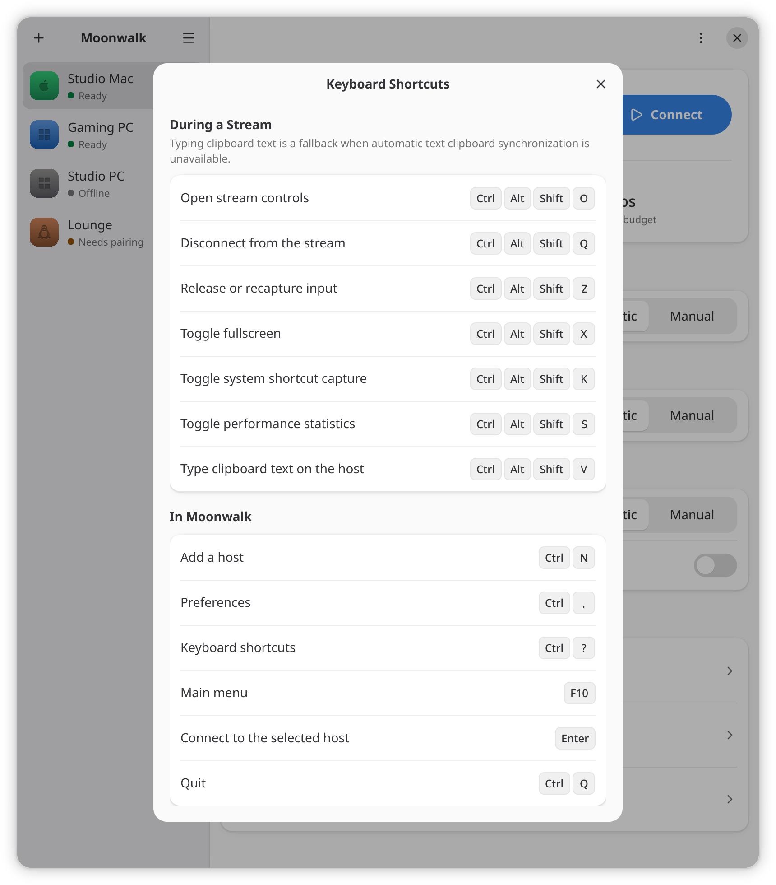

# While you're streaming

## Stream controls

Click the pill in the middle of the top edge of the stream to open the bar. It shows which computer you're on and how the connection is doing, with buttons for sound, input, view scale, fullscreen or windowed, the full controls and disconnect. Hover over a button to see what it does and the keys that do the same thing. Move away and the bar leaves.

The handle stays in the middle, so the menus and panels on the host stay in reach. A small pill stays at the top of the stream the whole time, so you can always see you're streaming; it brightens as your pointer gets close, and clicking it opens the bar straight away. When a game is holding your pointer it can't get to the edge, so press **Ctrl+Alt+Shift+Z** to get it back. Narrow windows show fewer buttons.

For everything else, open the **Stream Controls** panel with **Ctrl+Alt+Shift+O**, or with the Controls button in that row. The stream keeps running, but your input stops going to the host until you return. Esc takes you back.

The panel shows how the connection is doing right now: round trip, frame rate and whether it's healthy. From it you can:

- mute the sound
- go fullscreen
- send system shortcuts to the host, or keep them on your computer
- use your local keyboard layout for typing
- change how the picture fits your window
- choose which way the clipboard works
- copy files
- disconnect

Disconnect returns to the regular Moonwalk window as soon as local video and input close. Ending the remote streaming session continues in the background. A notification appears if the host cannot confirm cleanup.

## Keyboard shortcuts

Hold **Ctrl+Alt+Shift** and press:

| Key | What it does |
| :---: | --- |
| **O** | Open Stream Controls |
| **Q** | End the streaming session and release its Desktop target |
| **Z** | Release your keyboard and mouse, or capture them again |
| **X** | Fullscreen on or off |
| **K** | Send system shortcuts to the host, or keep them here |
| **S** | Show or hide performance statistics |
| **V** | Type your clipboard's text on the host |

The same list is under **Keyboard Shortcuts** in Moonwalk's main menu.

Disconnecting requests Desktop session cleanup in the background. A streamed game
or app stays open unless **End games when you disconnect** is enabled in Preferences;
with that option enabled, unsaved work in the remote app may be lost.

  <picture>
    <source media="(prefers-color-scheme: dark)" srcset="../assets/shortcuts-dark.png">
    
  </picture>

## Fitting the picture

**Fit in Window** shows the whole remote screen. **Actual Size** shows one remote pixel for each pixel on your screen. If the picture is then larger than your window, release input and scroll to move around it, and click the picture when you want to control the host again.

These choices only change what you see. They don't resize the other computer's screen.

## Changing quality during a stream

Bitrate is how much data the stream uses each second, measured in Mbps. On Apollo-family hosts, Moonwalk checks whether the host can change it without reconnecting. If it can, Stream Controls has a bitrate slider. Changes apply right away, and if the host refuses one, the slider goes back to the last value it confirmed.

**Automatic** video quality, the default on hosts that support it, follows your network by itself. Stream Controls shows the encoder target; the actual data sent varies with the picture. The launch budget also allows for transport overhead, so it is a different number. A target is not an acknowledgement from the host that every bit is being used.

The controls also show whether video encryption was negotiated. Pairing and encrypted input do not by themselves mean the video is encrypted; the host must allow it.

## Copy and paste

With a supporting host, Stream Controls lets you share the clipboard in both directions, one direction, or not at all.

| | Text | Images | How |
| --- | :---: | :---: | --- |
| **Moonwalk Host** | ✓ | ✓ | Automatic |
| **Apollo and Vibepollo** | ✓ | | Automatic. The host's permissions decide which directions are allowed. |
| **Other hosts** | | | Copy text here, then press **Ctrl+Alt+Shift+V** to type it on the host. |

Images must be PNG, up to 4 MiB and 4096 pixels on each side. Anything larger is ignored and your clipboard stays as it was.

**A quirk on most current Linux desktops (those using Wayland):** your desktop may ignore a clipboard update until you've done something in that window. Click the stream before you copy. If pasting elsewhere doesn't work right after you disconnect, click or press a key in the Moonwalk window and try again.

## Copying files

File copying works with Moonwalk Host, in both directions, up to 8 GiB per file.

- **To the host:** drag files onto the stream or the Files section, or use **Choose Files…**. They go to the destination shown, which is the host's Downloads folder at first.
- **From the host:** browse its Downloads, Documents or Desktop folder, choose a file and a place to save it, then press **Receive File**. **Open Received Folder** shows you where it landed.

If a file of that name exists when sending, choose **Keep Both** or **Skip**. When receiving, pick another name or tick **Replace an existing local file**. Files are checked after copying and appear only once they're complete. Folders can't be copied as a group. Copying continues after you return to the stream, and disconnecting cancels anything still in progress.

macOS may refuse access to some folders. Moonwalk doesn't change permissions, so pick a folder that's allowed or grant access in System Settings on the Mac.

## When a connection drops

If the connection can be recovered, Moonwalk tries to pick up where it left off, with up to five attempts in a minute. You can cancel at any point. Cancelling recovery also ends the Desktop target retained for that retry.

A final disconnect ends the stream-owned Desktop target without logging you out or closing your desktop applications. The launcher returns while cleanup runs in the background. Cleanup requires the paired client's authenticated host state: a public discovery response saying the host is idle does not confirm that this client's target ended. For a separately launched game, the saved quit-app preference still applies. If the host cannot confirm cleanup, Moonwalk reports that uncertainty. A host that is offline may retain a paused target until its own cleanup policy runs or it can be reached again.

If it can't connect at all, a page names the host and offers:

- **Try Last Working Settings:** retries with the settings from the last healthy stream, without replacing your saved ones.
- **Retry with Safe Settings:** a temporary try at 1920×1080, 60 FPS and 10 Mbps. To keep them, choose **Keep Safe Settings** or **Keep for This Host** once video appears. Otherwise, they're forgotten when you disconnect.

## Fullscreen and windows

A windowed stream has your desktop's own title bar, which you can move and resize as usual. KDE Plasma draws it itself. On GNOME Moonwalk draws one that matches. On a desktop that arranges windows automatically, such as Hyprland, the desktop decides the size and Moonwalk follows. The controls follow your desktop's light or dark setting, even if you change it mid-stream.

---

Next: [Smoother streaming](performance.md) · [Troubleshooting](troubleshooting.md) · [All guides](README.md)

Performance recommendations appear in Stream Controls only when available. They are saved for the next connection; **Apply Now** briefly reconnects immediately at your request. Ignoring a recommendation keeps your current stream running.
